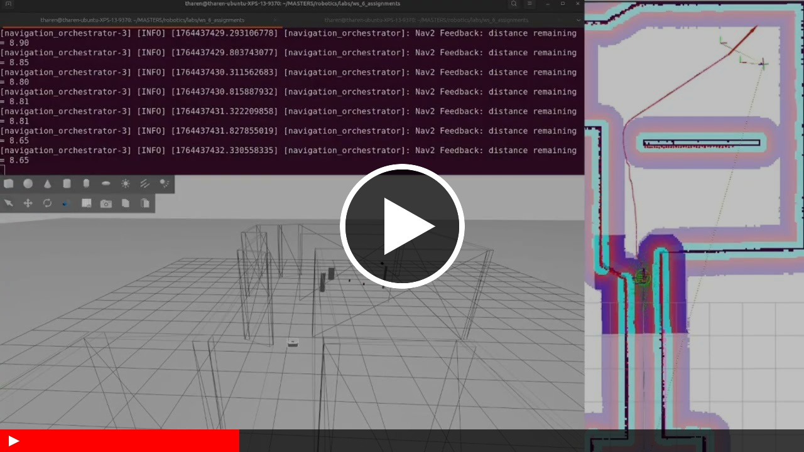
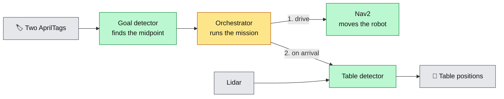
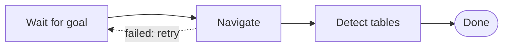

<div align="center">

# 🧭 Autonomous Navigation Between AprilTags

**A ROS 2 pipeline that finds a goal from two AprilTags, drives a mobile robot there with Nav2, and then detects the cylindrical tables around it using lidar.**


&nbsp;&nbsp;&nbsp; &nbsp;&nbsp;&nbsp; &nbsp;&nbsp;&nbsp; &nbsp;&nbsp;&nbsp; 


<a href="https://www.youtube.com/watch?v=E088HeOQk4g">
  
</a>

▶ *Click to watch the demo on YouTube*

</div>

---

## Overview

This project was built for *Intelligent Robotics* (MSc), Assignment 1. It is a four-node ROS 2 package (`group_6_assignment_1`) that takes a robot from "I know roughly where I am" to "I have found the tables":

1. The robot is told where it starts (an initial pose for localization).
2. Two **AprilTags** mark the destination. The robot works out a goal pose halfway between them, facing across the line that joins them.
3. **Nav2** drives the robot to that goal.
4. On arrival, the robot scans its surroundings with **lidar** and reports the positions of the **cylindrical tables** it can see.

If Nav2 rejects, aborts or cancels a goal, the orchestrator goes back and tries again.

---

## Features

- **Tag-defined goals:** the destination is computed from two AprilTag frames in the TF tree, so nothing is hard-coded.
- **Self-healing navigation:** a small state machine retries when Nav2 rejects, aborts or cancels a goal.
- **Lidar table detection:** laser points are clustered and filtered by size to find cylinders.
- **Tunable without recompiling:** offsets, size limits and the starting pose live in YAML files.
- **One-command launch:** a single launch file starts the simulation, tag detection and all four nodes.
- **CI:** every push and pull request to `main` builds the package on ROS 2 Jazzy.

---

## How It Works

### System at a glance



In short: the tags give a goal, the **orchestrator** sends the robot there with **Nav2**, and once it has arrived the **table detector** reads the lidar to find the tables. Behind the scenes, the initial pose publisher tells AMCL where the robot starts.

### The orchestrator's states



The orchestrator waits for a goal, drives to it, then detects the tables. If Nav2 rejects, aborts or cancels the goal, it goes back to waiting and tries again.

*In the code these steps are the `PRE_NAVIGATING`, `NAVIGATING` and `IDLE` states. Detection is a service call made right after a successful navigation, and the orchestrator ends in `IDLE` whether or not it found tables.*

### The nodes

| Node | What it does |
|---|---|
| **Initial pose publisher** | Sends the robot's starting pose to AMCL and keeps republishing it until AMCL confirms it, so localization always starts correctly |
| **Goal detector** | Looks up two AprilTag frames (IDs 1 and 10 by default), computes the midpoint, turns the robot perpendicular to the line between them, and publishes the result as the goal |
| **Navigation orchestrator** | Waits for a goal, sends it to Nav2, watches the result, retries on failure, and calls the table detector on arrival |
| **Table detection server** | On request, clusters the latest lidar scan, keeps clusters that match a cylinder's size, and returns their positions |

### Interfaces

| Type | Name | Direction | Content |
|---|---|---|---|
| Topic | `g_pos` | Goal detector → Orchestrator | Goal pose (`PoseStamped`) in the output frame |
| Action | `navigate_to_pose` | Orchestrator → Nav2 | Drive the robot to the goal |
| Service | `detect_tables` | Orchestrator → Table detection server | Empty request; response has `table_positions[]`, `success`, `message` |
| Topic | `cylinder_poses` | Table detection server → anyone | All detected cylinders as a `PoseArray` |
| Topic | `initialpose` | Initial pose publisher → AMCL | Starting pose with covariance |

---

## Getting Started

### Prerequisites

- **ROS 2 Jazzy** (Ubuntu 24.04), the version the CI builds against
- **Nav2** and **AMCL**
- The course package **`ir_launch`**, which provides the simulation (`assignment_1.launch.py`)
- An AprilTag detector for ROS 2 (`apriltag_msgs` is a dependency)

### Build and run

From your ROS 2 workspace:

```bash
colcon build --packages-select group_6_assignment_1
source install/setup.bash
ros2 launch group_6_assignment_1 group_6_assignment_1.launch.py
```

The launch file does everything in one go:

1. Starts the simulation (`ir_launch assignment_1.launch.py`) with its output sent to log files to keep the terminal clean.
2. Starts the AprilTag detector, also with its output logged.
3. Starts the navigation orchestrator, goal detector, initial pose publisher and table detection server.

Watch the terminal for the orchestrator's messages: *goal accepted*, *navigation succeeded*, and the list of detected tables.

---

## Configuration

Parameters live in [`config/`](config/):

| File | Parameter | Default | Meaning |
|---|---|---|---|
| [`goal_detector.yaml`](config/goal_detector.yaml) | `output_frame` | `map` | Frame the goal is published in |
| | `tag1_frame`, `tag2_frame` | `tag36h11:1`, `tag36h11:10` | The two tags the goal is computed from |
| | `yaw_offset_rad` | `-π/2` | Turns the robot to face perpendicular to the line between the tags |
| | `distance_offset` | `0.10` m | Shifts the goal away from the midpoint along that perpendicular |
| [`initial_pose_pub.yaml`](config/initial_pose_pub.yaml) | `x`, `y`, `z`, `qx`…`qw` | origin, no rotation | Starting pose given to AMCL |
| | `cov_xx`, `cov_yy`, `cov_aa` | `0.5`, `0.5`, `0.1` | Starting pose uncertainty |
| [`table_detection_server.yaml`](config/table_detection_server.yaml) | `min_cluster_size` | `2` | Fewest lidar points that count as an object |
| | `min_cylinder_width`, `max_cylinder_width` | `0.05`, `0.5` m | Accepted cylinder size |
| | `cluster_proximity_threshold` | `0.25` m | Largest gap between points in one cluster |
| | `max_cylinder_detection_range` | `3.0` m | Ignore objects farther than this |
| [`custom_tags_36h11.yaml`](config/custom_tags_36h11.yaml) | *(AprilTag settings)* | | Tag family `36h11` detector configuration |

---

## Testing Pieces Individually

Each node can be run alone with its parameter file, which is handy for debugging:

```bash
ros2 run group_6_assignment_1 goal_detector --ros-args --params-file config/goal_detector.yaml
ros2 run group_6_assignment_1 table_detection_server --ros-args --params-file config/table_detection_server.yaml
```

To trigger table detection by hand (while the robot is simulated and the lidar is publishing):

```bash
ros2 service call /detect_tables group_6_assignment_1/srv/DetectTables "{}"
```

---

## Troubleshooting

| Symptom | What to try |
|---|---|
| The robot never starts moving | The orchestrator waits for a goal on `g_pos`. Check that both tag frames exist: `ros2 run tf2_tools view_frames`, and look for `tag36h11:1` and `tag36h11:10` |
| The goal is rejected repeatedly | The orchestrator retries on its own. Check Nav2 is active and the initial pose was accepted (`ros2 topic echo /amcl_pose`) |
| No tables detected | Make sure `/scan` is publishing, and widen `max_cylinder_width` or `max_cylinder_detection_range` |
| Simulation errors are hidden | The launch file sends simulation and AprilTag output to log files. Look in `~/.ros/log` |

---

## Repository Layout

```
├── src/               The four nodes
├── srv/               DetectTables service definition
├── config/            YAML parameters
├── launch/            Full-pipeline launch file and AprilTag wrapper
├── include/           Headers
├── .github/workflows/ CI build on ROS 2 Jazzy
├── CMakeLists.txt
└── package.xml
```

---

## Team Members

**[Dawit Andargachew Asmare](https://github.com/dawit-andargachew) · [Tharen Emmanuel Candi](https://github.com/tharencandi) · [Giuseppe Castellana](https://github.com/g-castel15)**

The follow-up project, a UR5 arm that swaps two cubes between tables, is in [ros2-ur5-vision-based-cube-swap](https://github.com/dawit-andargachew/ros2-ur5-vision-based-cube-swap).

## License

Released under the [Apache License 2.0](LICENSE).
